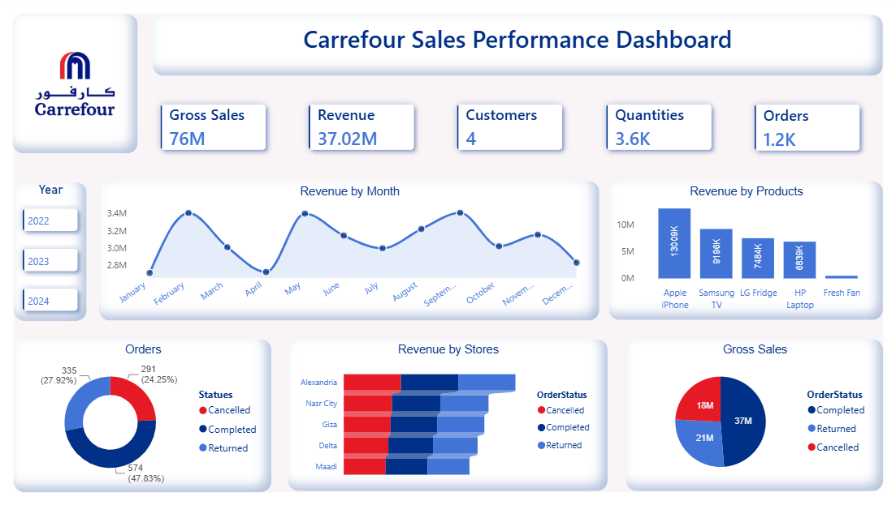

# Carrefour_Sales_Performance_Dashboard

A project from the *Data Analysis Diploma* at Tech Mind Academy, building an interactive Sales Dashboard with *Power Query*, *Microsoft Excel* and *Power BI*, analyzing sales performance data across synthetic transactions.

> ⚠️ **Note on Data Authenticity:** The dataset utilized for this project was synthesized entirely at random for training and educational purposes; it does not represent any real-world operational or financial metrics of Carrefour.

## 📁 Files Included

| File | Description |
|------|-------------|
| Carrefour_Sales_Data.xlsx | Raw data (Transactions, Stores, and Products) |
| Carrefour_Sales_Dashboard.pbix | Power BI dashboard file |
| Dashboard.png | Dashboard preview |

## 📌 Key Metrics

- **Core Business Performance:** 37.02M Total Revenue | 76M Gross Sales.
- **Volume & Reach:** 1.2K Total Orders | 3.6K Quantities Sold | 4 Active Customers.
- **Order Status Split:** Completed (574 / 47.83%) | Returned (335 / 27.92%) | Cancelled (291 / 24.25%).
- **Top Channel:** Hyper represents the largest revenue share in Store Types.

## 🧹 Data Preparation

The synthetic source data contained duplicates, inconsistent store names, and unformatted text (e.g., redundant brand text in store names). These were resolved with Power Query before modeling the data into a star schema.

## 🛠️ Tools & Skills

- Power BI Desktop (Data Modeling, DAX, Visuals)
- Power Query (ETL and data cleaning) and Microsoft Excel (data preparation)
- Data Relationships using Star Schema across 4 tables (Sales Fact, DimCustomer, DimProducts, DimStores)

## 📊 Dashboard Features

- **Slicers:** filter by Year (2022-2024)
- **KPI cards:** Revenue, Gross Sales, Orders, Quantities, and Customers
- **Line chart:** Revenue by Month trend analysis
- **Stacked bar chart:** Revenue by Stores & Order Status (Completed, Returned, Cancelled)
- **Column chart:** Revenue by ProductName (Apple iPhone, Samsung TV, LG Fridge, etc.)
- **Treemap visual:** Revenue by Store Type (Online Hub, Express, Hyper)

## 💡 Key Business Recommendations

- **Gross-to-Net Gap:** Net revenue is 37.02M against 76M gross sales (under half). Returns and cancellations (over 52% of orders) are the first place to look, along with any discounting that may explain the gap.
- **Order Cancellation Monitoring:** The 24.25% cancellation rate signals a need for investigating transaction drops and optimizing fulfillment.
- **Return Rate Management:** Returned orders at 27.92% require a deeper look into product quality or customer service policies at top branches.
- **Channel Optimization:** Hyper drives the largest revenue share, so channel resources should be reviewed against the Online Hub and Express segments.
